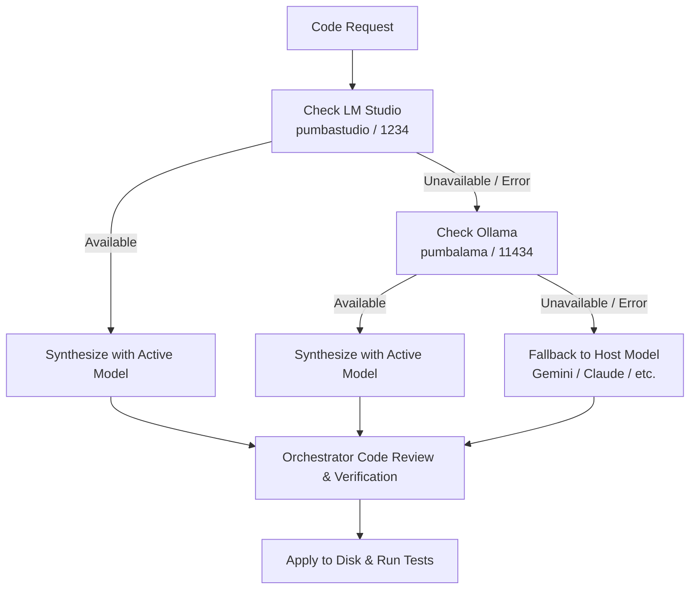

# Project Setup Template

Reusable bootstrap template containing universal AI coding agent rules, local-first code delegation standards, offline documentation caching, and cross-platform skills for initializing software projects.


---

## Overview

**Project Setup Template** standardizes how AI coding assistants (Antigravity, Claude Code, Codex, Cursor, OpenCode, and compatible tools) operate across software repositories. Instead of recreating operational rules and tooling hooks in every repository, this template provides a single, canonical rule file (`AGENTS.md`), its synchronized mirror (`.agents/rules/AGENTS.md`), environment adapters (`CLAUDE.md`), and reusable agent skills with native slash-command integrations.

It enforces five architectural pillars in AI-assisted engineering:

- **English-First Hygiene & Clean Commits**: Enforces English for all source code, identifiers, comments, documentation, and Conventional Commits without AI attribution or co-author trailers.
- **Local-First Code Delegation**: Offloads code, test, and script synthesis to local LLMs (`pumbastudio` via LM Studio and `pumbalama` via Ollama) targeting whichever model is currently loaded in memory, keeping cloud models for orchestration.
- **Zero Hallucination with Library Context Briefs**: Requires orchestrators to assemble verified API surfaces, versions, and usage constraints from lockfiles and documentation before prompting code synthesizers.
- **Cache-Aside Documentation Architecture**: Keeps raw third-party documentation on disk in `.context/<library>@<version>.md` (Git-ignored) via Context7, separating API reference caches from architectural memory (Engram).
- **Cross-Platform Skills & Commands**: Ships modular skills (such as `update-readme`) wired directly to native agent command interfaces (`.claude/commands/` and `.opencode/commands/`).

Application-specific runtimes, package manifests, builds, linters, and test suites are intentionally omitted; configure them in projects initialized from this template.

---

## Table of Contents

- [Overview](#overview)
- [Quick Start](#quick-start)
- [Prerequisites](#prerequisites)
- [Included Assets & Directory Structure](#included-assets--directory-structure)
- [Built-In Skills & Commands](#built-in-skills--commands)
- [Core Rules & Standards](#core-rules--standards)
- [Local LLM Code Delegation](#local-llm-code-delegation)
- [Documentation Cache & Memory Protocol](#documentation-cache--memory-protocol)
- [Sync Invariant](#sync-invariant)
- [Troubleshooting](#troubleshooting)
- [Contributing](#contributing)

---

## Quick Start

### Bootstrap a New Project

Copy the rule payloads, skills, and agent adapters into your target repository root:

```bash
# 1. Copy the canonical rules and mirror
cp AGENTS.md /path/to/your-project/
cp -r .agents /path/to/your-project/

# 2. Copy Claude Code and OpenCode command adapters
cp CLAUDE.md /path/to/your-project/
cp -r .claude /path/to/your-project/
cp -r .opencode /path/to/your-project/

# 3. Add documentation cache and agent artifacts to target .gitignore
cat << 'EOF' >> /path/to/your-project/.gitignore

# AI Documentation Cache & Tooling State
.context/
.atl/
.codegraph/
EOF
```

### Verify Rule Synchronization

Whenever modifying rules in this template repository, verify that the canonical file and mirror remain identical:

```bash
git diff --no-index AGENTS.md .agents/rules/AGENTS.md
```

An empty output confirms both files match byte-for-byte.

---

## Prerequisites

- **Git** (`2.x+`) for version control and running synchronization checks (`git diff --no-index`).
- **Node.js & `npx`** (`18+` recommended) to run local MCP stdio servers (`@mzxrai/mcp-openai` and `ollama-mcp-server`).
- **Local LLM Engine** (at least one recommended for local code synthesis):
  - [LM Studio](https://lmstudio.ai/) running its local server on `http://127.0.0.1:1234/v1` with an active model loaded.
  - [Ollama](https://ollama.com/) running on `http://127.0.0.1:11434` with an active model pulled.
- **Documentation Provider**: Context7 MCP server for retrieving current library APIs and saving to `.context/`.
- **Supported AI Agents**: Antigravity, Claude Code, OpenCode, Cursor, Codex, or any tool supporting `AGENTS.md` and MCP servers.

---

## Included Assets & Directory Structure

```
projectsetup/
├── .agents/
│   ├── rules/
│   │   └── AGENTS.md                          # Byte-identical mirror of AGENTS.md
│   └── skills/
│       └── update-readme/
│           ├── SKILL.md                       # Canonical update-readme skill instructions
│           └── references/
│               └── archetypes-and-checklists.md # Matrix, blueprints & verification checklists
├── .claude/
│   └── commands/
│       └── update-readme.md                   # /update-readme slash command for Claude Code
├── .opencode/
│   └── commands/
│       └── update-readme.md                   # /update-readme slash command for OpenCode
├── AGENTS.md                                  # Canonical cross-agent rules & delegation standards
├── CLAUDE.md                                  # Claude Code entrypoint and adapter
├── .gitignore                                 # Git ignore patterns including .context/ cache
└── README.md                                  # Repository documentation
```

### File Responsibilities

| File / Directory | Target Agents | Purpose |
| :--- | :--- | :--- |
| [`AGENTS.md`](./AGENTS.md) | Universal (Antigravity, Cursor, OpenCode, Codex, etc.) | Canonical source of truth for agent behavior, delegation, and workflow rules. |
| [`.agents/rules/AGENTS.md`](./.agents/rules/AGENTS.md) | Tools expecting nested `.agents/` hierarchy | Byte-identical mirror of `AGENTS.md` verified by CI or pre-commit checks. |
| [`CLAUDE.md`](./CLAUDE.md) | Claude Code | Root configuration pointing to `@AGENTS.md` and defining Claude-specific bridge tools. |
| [`.agents/skills/update-readme/`](./.agents/skills/update-readme/) | Universal Skill | Evaluates repository manifests and entrypoints to generate and audit ground-truth READMEs. |
| [`.claude/commands/update-readme.md`](./.claude/commands/update-readme.md) | Claude Code | Exposes the `/update-readme` slash command inside Claude Code sessions. |
| [`.opencode/commands/update-readme.md`](./.opencode/commands/update-readme.md) | OpenCode | Exposes the `/update-readme` slash command inside OpenCode sessions. |

---

## Built-In Skills & Commands

### `/update-readme`

Audits, generates, or updates `README.md` and companion language files (`README.<lang>.md`) based strictly on repository ground truth (manifests, entrypoints, and CLI routers) without hallucinating commands or flags.

- **Trigger**: Run `/update-readme` (or `$update-readme`) in Claude Code, OpenCode, or Antigravity.
- **Skill Definition**: [`.agents/skills/update-readme/SKILL.md`](./.agents/skills/update-readme/SKILL.md)
- **Blueprints & Matrix**: [`.agents/skills/update-readme/references/archetypes-and-checklists.md`](./.agents/skills/update-readme/references/archetypes-and-checklists.md)
- **Supported Archetypes**:
  - **A. CLI & Desktop Application** (entrypoint parsing, CLI option tables, profile modes)
  - **B. Library / SDK / Package** (exports, minimal usage snippets, API tables)
  - **C. Web Application / Backend API Service** (env vars, migration commands, API endpoints)
  - **D. Bootstrap Template / Agent Rules Repository** (bootstrap steps, rule mirrors, sync invariants)

---

## Core Rules & Standards

### 1. Language and Documentation (MANDATORY)

- **English by default**: All source code, identifiers, function and variable names, comments, documentation (`docs/`, READMEs), and commit messages must be in English.
- **Translations**: Dedicated translation files (e.g., `README.es.md` or i18n catalogs) are the only exception.
- **Commit hygiene**: Commits follow Conventional Commits (`feat:`, `fix:`, `docs:`, `chore:`) without `Co-Authored-By` or AI attribution trailers.

### 2. Code Authorship & Delegation Hierarchy

Source code, tests, and scripts are synthesized by local LLM providers first. The orchestrating agent writes code itself only when local providers are unavailable:



#### What Local Models Write
- Source code (`src/`, `lib/`, etc.)
- Unit, integration, and end-to-end tests
- Scripts and executable routines

#### What the Orchestrating Agent Does Itself
- Codebase exploration, mapping, and planning
- Resolving library dependencies and assembling documentation briefs
- Applying synthesized code to disk and running test suites
- Architectural review for safety and correctness
- Writing documentation, configuration files, and commit messages

---

## Local LLM Code Delegation

### Dynamic Model Policy

Agents never hardcode specific model names. They dynamically target whichever model is active in memory:

1. **Primary Provider: `pumbastudio`**
   - Served by LM Studio (port `1234`), MCP tool `openai_chat`.
   - Uses the active loaded model identifier or local alias (e.g., `"gpt-4o"`).
2. **Secondary Provider: `pumbalama`**
   - Served by Ollama (port `11434`), MCP tool `chat_completion`.
   - Uses whichever model is currently active in memory.
3. **Fallback: Host Model**
   - Used when both local engines are offline or encounter GPU out-of-memory errors.

### MCP Configuration Reference

Add these servers to your agent's MCP configuration file:

```json
{
  "mcpServers": {
    "pumbastudio": {
      "command": "npx",
      "args": ["-y", "@mzxrai/mcp-openai@latest"],
      "env": {
        "OPENAI_BASE_URL": "http://127.0.0.1:1234/v1",
        "OPENAI_API_KEY": "sk-lm-local"
      }
    },
    "pumbalama": {
      "command": "npx",
      "args": ["-y", "ollama-mcp-server@latest"],
      "env": {
        "OLLAMA_HOST": "http://127.0.0.1:11434"
      }
    }
  }
}
```

### 5-Step Code Change Workflow

```
1. Explore & Plan ──> 2. Resolve Library Facts ──> 3. Prompt Local Model ──> 4. Review ──> 5. Apply & Verify
```

1. **Explore and Plan**: Inspect the target repository to determine changes. Never delegate exploration to local models.
2. **Resolve Library Facts (Cache-Aside Flow)**: Look up installed versions in lockfiles, check `.context/<lib>@<version>.md`, and assemble the **Library Context Brief**.
3. **Prepare Prompt**: Pass project rules as `system` instructions, and include the Library Context Brief, task description, target code verbatim, and expected output format.
4. **Review**: Validate the response against the brief and repository patterns. Reject any hallucinated or deprecated APIs.
5. **Apply and Test**: Save files and execute the project's verification suite.

---

## Documentation Cache & Memory Protocol

To prevent context bloat and hallucination, projects separate raw documentation from architectural knowledge:

| Storage Location | Tool / Path | Contents & Responsibility |
| :--- | :--- | :--- |
| **Local Cache (Disk)** | `.context/<library>@<version>.md` | Raw API documentation, exported signatures, and official usage examples fetched from Context7. Ignored by Git. |
| **Persistent Memory** | **Engram** (`mem_save`) | Project decisions, bug root causes, architectural patterns, and non-obvious code discoveries. Never store raw doc dumps here. |

---

## Sync Invariant

The rules in `AGENTS.md` and `.agents/rules/AGENTS.md` **must remain byte-identical**.

Whenever you update agent rules:
1. Apply edits to `AGENTS.md`.
2. Copy `AGENTS.md` to `.agents/rules/AGENTS.md`.
3. Verify synchronization:
   ```bash
   git diff --no-index AGENTS.md .agents/rules/AGENTS.md
   ```
4. Update `README.md` in the same commit if commands or standards changed.

---

## Troubleshooting

| Issue | Root Cause | Solution |
| :--- | :--- | :--- |
| `git diff --no-index AGENTS.md .agents/rules/AGENTS.md` returns differences | Edited only one of the rule files | Run `cp AGENTS.md .agents/rules/AGENTS.md` and verify with `git diff --no-index`. |
| `pumbastudio` fails to connect | LM Studio local server stopped or wrong port | Start LM Studio, verify local server is running on `127.0.0.1:1234`, and ensure a model is loaded. |
| `pumbalama` connection refused | Ollama daemon is not running | Run `ollama serve` or start Ollama service on `127.0.0.1:11434`. |
| Local model produces hallucinated or outdated APIs | Missing or incomplete Library Context Brief | Check lockfile for exact version, query Context7 into `.context/`, and pass explicit function signatures in the prompt. |
| `/update-readme` not recognized in Claude Code | Command file missing or in ignored directory | Ensure `.claude/commands/update-readme.md` exists and is readable by Claude Code. |

---

## Contributing

1. Edit [`AGENTS.md`](./AGENTS.md) and mirror every change to [`.agents/rules/AGENTS.md`](./.agents/rules/AGENTS.md).
2. If adding, renaming, or updating skills or commands, update [`.agents/skills/`](./.agents/skills/), `.claude/commands/`, `.opencode/commands/`, and this `README.md`.
3. Confirm byte-identical sync with `git diff --no-index AGENTS.md .agents/rules/AGENTS.md`.
4. Stage specific files explicitly (never run blanket `git add .` or stage `.context/`, `.atl/`, or `.codegraph/`).
5. Write commit messages following Conventional Commits in English without AI attribution.
