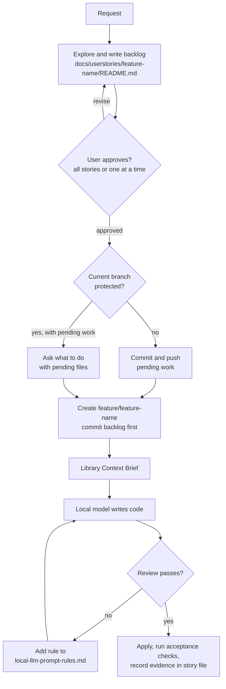
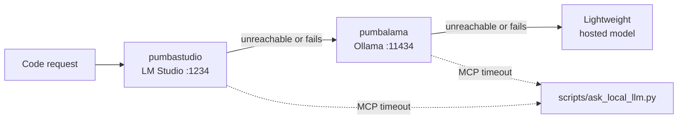

<div align="center">

# projectsetup

**One set of rules for every AI coding agent: backlog first, a branch per backlog, code from local models.**

Antigravity · Claude Code · Codex · Cursor · OpenCode

</div>

A reusable project setup template for AI coding agents. It ships one set of agent rules, a backlog-first workflow, local-model code delegation tooling, and a README skill that work the same way in every agent above. You keep one source of truth for how agents plan, branch, and delegate code, instead of a separate configuration per agent and per project.

> [!NOTE]
> The template has no application runtime, build, lint, or test suite. Projects that reuse it add their own commands.

## Contents

- [Quick start](#quick-start)
- [What is included](#what-is-included)
- [Skills and commands](#skills-and-commands)
- [Core rules and workflow](#core-rules-and-workflow)
- [Local-model code delegation](#local-model-code-delegation)
- [Library docs cache and Engram](#library-docs-cache-and-engram)
- [Sync invariant and verification](#sync-invariant-and-verification)
- [Troubleshooting](#troubleshooting)
- [Contributing](#contributing)

## Quick start

1. Copy the template files into the root of your project:

   ```bash
   cp -r AGENTS.md CLAUDE.md .agents .opencode scripts /path/to/your-project/
   ```

2. Add your project's architecture, dependencies, and commands to the `## Project Context` section of `AGENTS.md`.
3. Copy the same `AGENTS.md` to `.agents/rules/AGENTS.md`, then confirm both files are identical:

   ```bash
   git diff --no-index AGENTS.md .agents/rules/AGENTS.md
   ```

   No output means they are in sync.

4. Register the local-model MCP servers in your agent (see [MCP server setup](#mcp-server-setup)).

## What is included

```text
.
├── AGENTS.md                         # Canonical, agent-neutral rules
├── CLAUDE.md                         # Claude Code-specific guidance (imports AGENTS.md)
├── .agents/
│   ├── rules/AGENTS.md               # Byte-identical copy of AGENTS.md
│   ├── local-llm-guide.md            # Guide for prompting a 32k-context local model
│   ├── local-llm-prompt-rules.md     # System message for every local code request
│   └── skills/update-readme/         # README audit/update skill
├── .claude/
│   ├── commands/update-readme.md     # Exposes the skill as /update-readme in Claude Code
│   ├── skills/sync-llmtuner/         # Project skill for the llm-tuner site
│   └── launch.json                   # Claude Code preview server configurations
├── .opencode/commands/update-readme.md  # Exposes the skill as /update-readme in OpenCode
├── docs/userstories/                 # One backlog per feature
└── scripts/
    ├── ask_local_llm.py              # Fallback client for local models
    └── configure_ollama_models.sh    # Owner-specific Ollama model-path setup
```

| File | Purpose |
| :--- | :--- |
| [`AGENTS.md`](AGENTS.md) | Rules every agent reads at session start: language, backlog approval, story and QA contracts, code delegation, library docs. |
| [`CLAUDE.md`](CLAUDE.md) | Claude Code tool names, script usage, and repository hygiene. |
| [`.agents/local-llm-guide.md`](.agents/local-llm-guide.md) | Project-independent guide: token budget per request, one unit per request, request structure. |
| [`.agents/local-llm-prompt-rules.md`](.agents/local-llm-prompt-rules.md) | Short rules pasted into the system message. A rule is added each time a review rejects part of an answer. |

## Skills and commands

| Skill | Location | Invocation |
| :--- | :--- | :--- |
| `update-readme` | [`.agents/skills/update-readme/SKILL.md`](.agents/skills/update-readme/SKILL.md) | `/update-readme` in Claude Code ([`.claude/commands/update-readme.md`](.claude/commands/update-readme.md)) and OpenCode ([`.opencode/commands/update-readme.md`](.opencode/commands/update-readme.md)) |

`update-readme` audits, creates, or updates `README.md` and any `README.<lang>.md`. Its core rule: every command, flag, and path in a README must be proven by repository files.

| Reference | Defines |
| :--- | :--- |
| [`archetypes-and-checklists.md`](.agents/skills/update-readme/references/archetypes-and-checklists.md) | Which sections a README has, per project type. |
| [`visual-format.md`](.agents/skills/update-readme/references/visual-format.md) | How it looks: centered header, the project's logo and colors when tracked files define them, Mermaid diagrams, alerts. |

## Core rules and workflow

All rules are in [`AGENTS.md`](AGENTS.md). The essentials:

| Rule | Summary |
| :--- | :--- |
| Language | Code, comments, docs, and commit messages are in English. Only translations (`README.es.md`, i18n catalogs) use other languages. |
| Backlog approval | Before implementing, the agent saves a backlog of user stories (`US-01`, ...) to `docs/userstories/<feature-name>/README.md` and asks for approval. |
| Backlog branches | On approval, pending work on a non-protected branch is committed and pushed, then `feature/<feature-name>` is created from it. Protected branches (`main`, `master`, the remote default) never get agent commits. |
| Execution mode | The user chooses **all stories** (implemented in dependency order without asking again) or **one at a time** (stop for approval after each story). |
| Story readiness | Each story has an actor, goal, and value; acceptance criteria with IDs such as `US-01 / AC-01`; and a verification method. No invented business rules. |
| QA evidence | Tests derive from acceptance criteria or regression risks. Observe a failing test before implementing when a deterministic test exists. A story is complete only with observed evidence in its story file. |
| Roles | A reasoning model plans and reviews. Code is written by a local model first, then a lightweight hosted model; the planner writes code only with explicit user authorization. |
| Commits | Conventional Commits, no AI attribution lines. |

### Workflow per change



> [!WARNING]
> Agents never commit or push to protected branches (`main`, `master`, the remote default). Merges and pull requests stay with you.

## Local-model code delegation

Source code, tests, and scripts are synthesized by a local model. Docs, config, and commit messages are written by the agent. Model names are never hardcoded: the agent uses whichever model is loaded.



| Priority | Provider | Server | Port | MCP tool (Claude Code name) |
| :--- | :--- | :--- | :--- | :--- |
| 1 | `pumbastudio` | LM Studio | `1234` | `openai_chat` (`mcp__pumbastudio__openai_chat`) |
| 2 | `pumbalama` | Ollama | `11434` | `chat_completion` (`mcp__pumbalama__chat_completion`) |
| 3 | Lightweight hosted model | Current client | n/a | Client's own delegation mechanism |

### MCP server setup

```json
{
  "mcpServers": {
    "pumbastudio": {
      "command": "npx",
      "args": ["-y", "@mzxrai/mcp-openai@latest"],
      "env": {
        "OPENAI_BASE_URL": "http://127.0.0.1:1234/v1",
        "OPENAI_API_KEY": "sk-lm-local"
      }
    },
    "pumbalama": {
      "command": "npx",
      "args": ["-y", "ollama-mcp-server@latest"],
      "env": {
        "OLLAMA_HOST": "http://127.0.0.1:11434"
      }
    }
  }
}
```

### Fallback script: `ask_local_llm.py`

Use it when the MCP tool times out or cannot turn reasoning off. It is stdlib-only Python. It puts `.agents/local-llm-prompt-rules.md` in the system message and sends `reasoning_effort: "none"` unless `--think` is passed.

```bash
python3 scripts/ask_local_llm.py --user request.md --out answer.md --code-out file.py
```

| Flag | Description | Default |
| :--- | :--- | :--- |
| `--user <file>` | User message (the request). Required. | n/a |
| `--out <file>` | Where the full answer is saved. Required. | n/a |
| `--code-out <file>` | Saves the first fenced code block of the answer. Exits with code 1 if there is none. | not set |
| `--system <file>` | Extra system text, placed before the rules file. | not set |
| `--provider lmstudio\|ollama` | Local server to call. | `lmstudio` |
| `--think` | Leaves reasoning on (does not send `reasoning_effort: "none"`). | off |
| `--timeout <seconds>` | Request timeout. | `1800` |

On success it prints the model, elapsed seconds, token counts, and tokens per second.

### Ollama model directory: `configure_ollama_models.sh`

Installs a systemd drop-in (`/etc/systemd/system/ollama.service.d/models.conf`) that sets `OLLAMA_MODELS` for the system Ollama service, then restarts it.

**Owner-specific:** the model path is hardcoded to the owner's machine (`/run/media/pumba/DataBases/Models/Ollama`). Edit `MODELS` in the script before using it elsewhere.

```bash
sudo sh scripts/configure_ollama_models.sh
```

## Library docs cache and Engram

Local models have fixed knowledge cutoffs, so every code request includes a Library Context Brief: runtime and exact library versions, the current API, recent changes, forbidden APIs, one official example, and one existing call site.

| Store | Holds |
| :--- | :--- |
| `.context/<library>@<version>.md` | Raw third-party docs for the exact installed version. On a miss, the agent queries Context7 or official docs and saves the result here. |
| Engram (`mem_save`) | Project-specific discoveries, gotchas, decisions, and bug root causes. Never raw third-party docs. |

## Sync invariant and verification

- `AGENTS.md` is canonical. `.agents/rules/AGENTS.md` must be byte-identical, and this README summarizes the rules. A rule change touches all three in the same commit.
- Verify the copy:

  ```bash
  git diff --no-index AGENTS.md .agents/rules/AGENTS.md
  ```

## Troubleshooting

| Symptom | Cause and fix |
| :--- | :--- |
| `Cannot reach http://127.0.0.1:1234: ...` | LM Studio is not running. Start it, or retry with `--provider ollama`. |
| `Ollama has no model loaded` | Load a model in Ollama, then rerun. |
| `No code block in the answer` | The answer had no fenced code block. Check the file passed to `--out`. |
| `Run with: sudo sh ...` | `configure_ollama_models.sh` must run as root. |
| `Different configuration already exists at ...` | The script refuses to overwrite an existing drop-in. Review `/etc/systemd/system/ollama.service.d/models.conf` manually. |

## Contributing

Maintained by [@ronald32acunadev](https://github.com/ronald32acunadev). Ask questions or report problems in this repository's [issues](https://github.com/ronald32acunadev/projectsetup/issues); propose changes as pull requests against `main`.

- Follow the backlog and QA rules in [`AGENTS.md`](AGENTS.md).
- Use Conventional Commits with no AI attribution lines.
- Stage files explicitly; never use a blanket `git add`. `.atl/`, `.codegraph/`, and `.superpowers/` are local tooling state.
